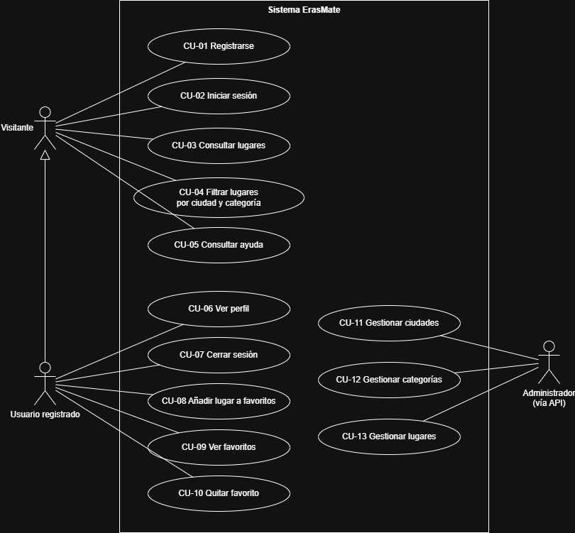
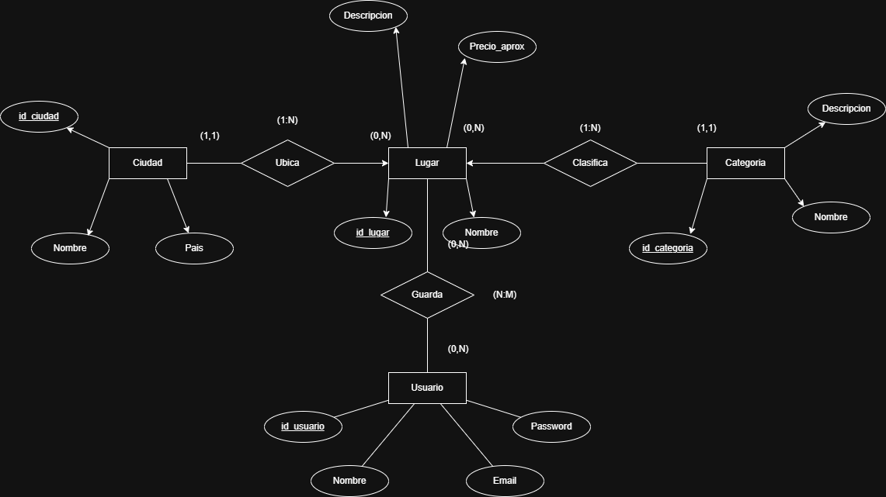
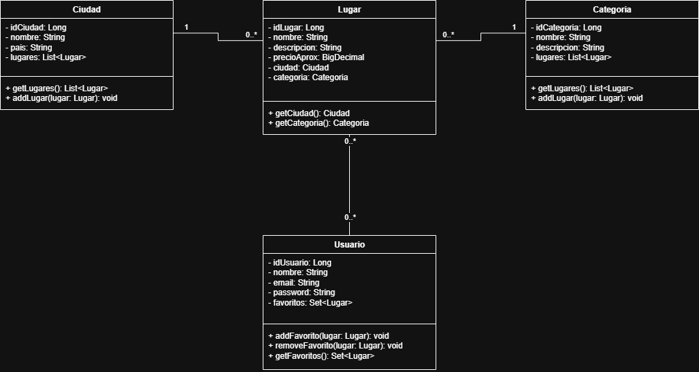
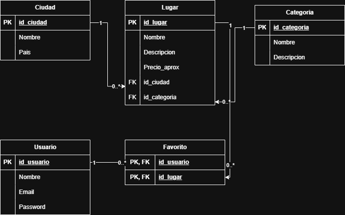

# ErasMate · Backend

API REST de **ErasMate**, una aplicación para estudiantes Erasmus en Canarias. Permite consultar lugares útiles (trámites, transporte, ocio, playas y restaurantes), registrarse, iniciar sesión y guardar lugares favoritos.

Proyecto de **Acceso a Datos** (2º DAM, IES El Rincón). El frontend está en otro repositorio: [erasmate](https://github.com/danilogar019-dotcom/erasmate) (React + Vite).

## 1. Descripción del sistema

El backend está hecho con Spring Boot y guarda los datos en MariaDB usando JPA/Hibernate. El frontend en React consume la API.

Funcionalidades:

- Consultar ciudades, categorías y lugares, y filtrar los lugares por ciudad y por categoría.
- Registrarse e iniciar sesión. La contraseña se guarda cifrada con BCrypt.
- Añadir, ver y quitar lugares favoritos.
- CRUD completo de ciudades, categorías y lugares desde la API.

## 2. Casos de uso

| Código | Caso de uso | Actor | Descripción |
|---|---|---|---|
| CU-01 | Registrarse | Visitante | Crea una cuenta con nombre, email y contraseña. Si el email ya existe, avisa. |
| CU-02 | Iniciar sesión | Visitante | Entra con email y contraseña. Si son incorrectos, muestra un error. |
| CU-03 | Consultar lugares | Visitante | Ve la lista de lugares con su ciudad, categoría y precio. |
| CU-04 | Filtrar lugares | Visitante | Filtra los lugares por ciudad y/o categoría. |
| CU-05 | Consultar ayuda | Visitante | Lee la página de ayuda de la aplicación. |
| CU-06 | Ver perfil | Usuario registrado | Ve su nombre y email. Solo con sesión iniciada. |
| CU-07 | Cerrar sesión | Usuario registrado | Sale de su cuenta tras confirmar. |
| CU-08 | Añadir favorito | Usuario registrado | Guarda un lugar en favoritos desde la página de lugares. |
| CU-09 | Ver favoritos | Usuario registrado | Ve sus lugares favoritos en el perfil. |
| CU-10 | Quitar favorito | Usuario registrado | Quita un lugar de favoritos desde Lugares o desde el perfil. |
| CU-11 a CU-13 | Gestionar ciudades, categorías y lugares | Administrador | Crear, consultar, modificar y borrar a través de la API. |

El usuario registrado puede hacer todo lo que hace el visitante. El administrador no tiene pantalla en la aplicación: gestiona los datos llamando a la API (en `api.http` están todas las peticiones).

## 3. Modelo de datos

### 3.1 Esquema E/R

Hay cuatro entidades: **Ciudad**, **Categoria**, **Lugar** y **Usuario**.

- **Ubica** (Ciudad - Lugar, 1:N): cada lugar está en una sola ciudad y una ciudad puede tener muchos lugares.
- **Clasifica** (Categoria - Lugar, 1:N): cada lugar tiene una sola categoría y una categoría puede tener muchos lugares.
- **Guarda** (Usuario - Lugar, N:M): un usuario puede guardar muchos lugares como favoritos y un lugar puede ser favorito de muchos usuarios.

### 3.2 Diagrama UML

Cada entidad es una clase con sus atributos privados. Las relaciones 1:N se ven como un atributo `ciudad` y `categoria` en `Lugar`, y como una lista de lugares en `Ciudad` y `Categoria`. La relación N:M se ve como un `Set<Lugar> favoritos` en `Usuario`, con los métodos `addFavorito` y `removeFavorito`.

### 3.3 Modelo relacional

Cada entidad pasa a ser una tabla. Las relaciones 1:N se resuelven con una clave ajena en `lugar` (`id_ciudad` e `id_categoria`). La relación N:M se resuelve con la tabla intermedia `favorito`, cuya clave primaria está formada por las dos claves ajenas.

### 3.4 Campos, claves y relaciones

**ciudad**

| Campo | Tipo | Clave | Nulo | Descripción |
|---|---|---|---|---|
| id_ciudad | BIGINT | PK | No | Identificador, autoincremental |
| nombre | VARCHAR(100) | | No | Nombre de la ciudad |
| pais | VARCHAR(100) | | No | País de la ciudad |

**categoria**

| Campo | Tipo | Clave | Nulo | Descripción |
|---|---|---|---|---|
| id_categoria | BIGINT | PK | No | Identificador, autoincremental |
| nombre | VARCHAR(100) | | No | Nombre de la categoría (Ocio, Playas…) |
| descripcion | VARCHAR(255) | | Sí | Descripción breve |

**lugar**

| Campo | Tipo | Clave | Nulo | Descripción |
|---|---|---|---|---|
| id_lugar | BIGINT | PK | No | Identificador, autoincremental |
| nombre | VARCHAR(150) | | No | Nombre del lugar |
| descripcion | VARCHAR(500) | | Sí | Descripción del lugar |
| precio_aprox | DECIMAL(10,2) | | Sí | Precio aproximado en euros (0 = gratis) |
| id_ciudad | BIGINT | FK | No | Ciudad donde está (referencia a `ciudad`) |
| id_categoria | BIGINT | FK | No | Categoría del lugar (referencia a `categoria`) |

**usuario**

| Campo | Tipo | Clave | Nulo | Descripción |
|---|---|---|---|---|
| id_usuario | BIGINT | PK | No | Identificador, autoincremental |
| nombre | VARCHAR(100) | | No | Nombre del usuario |
| email | VARCHAR(150) | UNIQUE | No | Email para iniciar sesión, no se puede repetir |
| password | VARCHAR(255) | | No | Contraseña cifrada con BCrypt |

**favorito**

| Campo | Tipo | Clave | Nulo | Descripción |
|---|---|---|---|---|
| id_usuario | BIGINT | PK, FK | No | Usuario (referencia a `usuario`) |
| id_lugar | BIGINT | PK, FK | No | Lugar favorito (referencia a `lugar`) |

## 4. ORM

El mapeo se hace con anotaciones de JPA. Hibernate crea y actualiza las tablas al arrancar (`ddl-auto=update`).

| Clase | Tabla | Relaciones mapeadas |
|---|---|---|
| `Ciudad` | ciudad | `@OneToMany(mappedBy = "ciudad")` con Lugar |
| `Categoria` | categoria | `@OneToMany(mappedBy = "categoria")` con Lugar |
| `Lugar` | lugar | `@ManyToOne` + `@JoinColumn` con Ciudad y con Categoria |
| `Usuario` | usuario | `@ManyToMany` + `@JoinTable(name = "favorito")` con Lugar |

Detalles:

- Las listas de lugares de `Ciudad` y `Categoria` llevan `@JsonIgnore` para que el JSON no entre en bucle.
- La contraseña lleva `@JsonProperty(access = WRITE_ONLY)`: se recibe al registrarse pero nunca se devuelve.
- Cada entidad tiene su repositorio (`JpaRepository`) con consultas derivadas, por ejemplo `findByCiudad_IdCiudadAndCategoria_IdCategoria` para los filtros o `existsByEmail` para el registro.

## 5. Tecnologías, requisitos y ejecución

**Tecnologías:** Java 25, Spring Boot 4.1.2 (Web, Data JPA), Hibernate, MariaDB, Maven, `spring-security-crypto` (BCrypt).

**Requisitos:** JDK 25, XAMPP (MariaDB), IntelliJ IDEA (o Maven) y, para el frontend, Node.js.

**Configuración** (`src/main/resources/application.properties`):

- Puerto de la API: `8081` (el 8080 lo usa Apache de XAMPP).
- Base de datos: `jdbc:mariadb://localhost:3306/erasmate`, usuario `root` sin contraseña.

**Ejecución:**

1. Arrancar MySQL/MariaDB en XAMPP y crear la base de datos `erasmate`.
2. Ejecutar `ErasmateBackendApplication` desde IntelliJ (o `mvn spring-boot:run`). Las tablas se crean solas y se cargan datos de prueba de Canarias.
3. La API queda en `http://localhost:8081/api`.
4. Para el frontend: en el repositorio `erasmate`, `npm install` y `npm run dev`, y abrir `http://localhost:5173`.

Usuario de prueba: `demo@erasmate.com` / `erasmate2026`.

**Endpoints:**

| Recurso | Endpoints |
|---|---|
| Ciudades | `GET/POST /api/ciudades`, `GET/PUT/DELETE /api/ciudades/{id}` |
| Categorías | `GET/POST /api/categorias`, `GET/PUT/DELETE /api/categorias/{id}` |
| Lugares | `GET /api/lugares?ciudad=&categoria=`, `POST /api/lugares`, `GET/PUT/DELETE /api/lugares/{id}` |
| Usuarios | `POST /api/usuarios` (registro), `POST /api/usuarios/login`, `GET /api/usuarios/{id}` |
| Favoritos | `GET /api/usuarios/{id}/favoritos`, `POST/DELETE /api/usuarios/{id}/favoritos/{idLugar}` |

**Pruebas:** `CrudTest` prueba la conexión con la base de datos, un CRUD completo de lugar y la relación N:M de favoritos. Todas las peticiones de la API están en `api.http`.

## 6. Manuales

- [Manual de instalación](docs/manual-instalacion.pdf)
- [Manual de usuario](docs/manual-usuario.pdf)
